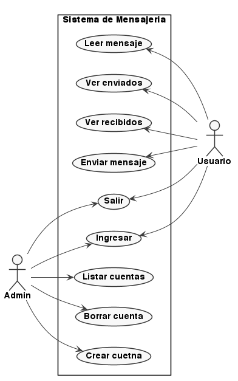
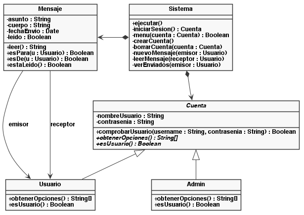
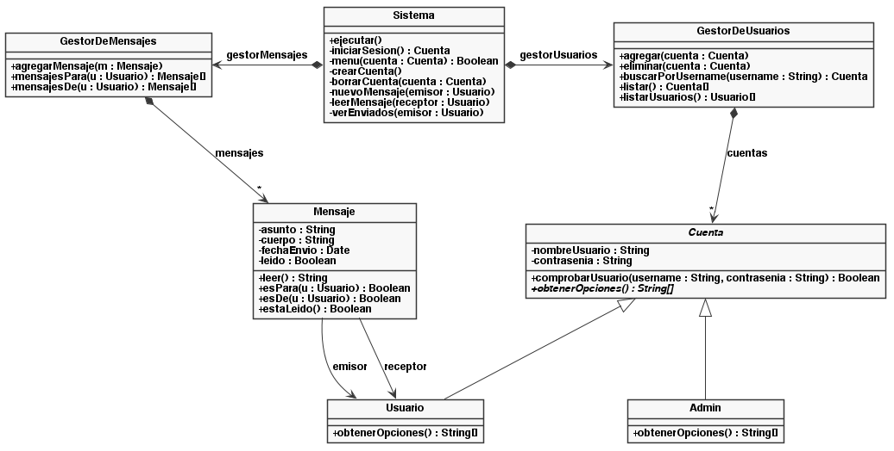
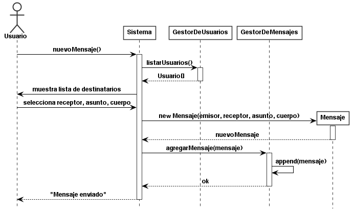

# Sistema de Mensajería Interna

Implementación de referencia del **Anexo A** del curso de Desarrollo de Aplicaciones Informáticas (5° año). El proyecto ilustra el proceso completo de análisis y diseño orientado a objetos, desde un documento de requerimientos hasta el código en Python.

El dominio es un sistema de mensajería interna para una organización pequeña: usuarios que pueden enviarse mensajes entre sí, y administradores que gestionan las cuentas.

## Estado del proyecto

El diseño sigue un camino directo desde el análisis del enunciado hasta el código, con un `Sistema` que concentra la lógica de las operaciones. El anexo cierra con una pregunta abierta sobre la extensibilidad de este diseño.

Una versión posterior del mismo sistema, refactorizada con el patrón **Command**, está en desarrollo como **Anexo B**.

## Documentación de diseño

Los diagramas UML están en `docs/diagramas/`. Cada uno tiene su fuente en formato PlantUML (`.puml`) y su versión compilada (`.png`).

### Casos de uso



Los dos actores del sistema son **Usuario** (envía y recibe mensajes) y **Admin** (gestiona cuentas). Los casos de uso "Ingresar" y "Salir" son comunes a ambos.

### Diagrama de clases inicial



Este es el primer diseño que surge directamente del análisis. El `Sistema` mantiene las dos colecciones (cuentas y mensajes) como atributos propios y contiene todos los métodos de negocio.

### Diagrama de clases refinado



El refactor de la sección 9 introduce dos **gestores** (fachadas) que encapsulan las colecciones. El `Sistema` deja de manipular las listas directamente y les delega las operaciones.

### Diagrama de secuencia



Flujo del caso de uso "enviar mensaje", desde que el usuario elige la opción del menú hasta que el mensaje queda guardado en el gestor correspondiente.

## Estructura del proyecto

```
.
├── mensajeria
│   ├── __init__.py
│   ├── constantes.py  # etiquetas del menú, centralizadas
│   ├── gestores.py    # GestorDeUsuarios, GestorDeMensajes
│   ├── modelo.py      # Cuenta, Usuario, Admin, Mensaje
│   ├── sistema.py     # Sistema (el orquestador)
│   └── ui.py          # utilidades de entrada/salida
├── tests
│   ├── __init__.py
│   ├── test_gestores.py
│   ├── test_modelo.py
│   └── test_sistema.py
├── docs
│   └── diagramas
│       ├── casos-uso.puml
│       ├── clases-01.puml
│       ├── clases-02.puml
│       └── secuencia.puml
├── main.py
├── pytest.ini
├── README.md
└── requirements.txt
```


## Instalación

Requiere Python 3.10 o superior.

```bash
python -m venv .venv
source .venv/bin/activate       # Linux/macOS
# .venv\Scripts\Activate.ps1     # Windows

pip install -r requirements.txt
```

## Ejecución

```bash
python main.py
```

Al iniciar, el sistema arranca con una cuenta de administrador por defecto creada por el gestor de usuarios:

- **Usuario**: `admin`
- **Contraseña**: `admin`

Desde esa cuenta se pueden crear otras cuentas de usuario o de administrador.

## Tests

```bash
pytest
```

La suite cubre:

- El modelo de dominio (`Cuenta`, `Usuario`, `Admin`, `Mensaje`).
- Los dos gestores y sus operaciones sobre las colecciones.
- El sistema, mockeando la interfaz de entrada/salida.

## Regenerar los diagramas

Los `.puml` se compilan con la extensión **PlantUML** de VSCode:

1. Instalar la extensión `jebbs.plantuml`.
1. Verificar que Java esté instalado.
1. Abrir cada `.puml` y usar `Alt+D` para exportar el PNG.

## Sobre el curso

Este proyecto forma parte del material del curso. El apunte completo (`Del problema al diseño: análisis orientado a objetos`) recorre paso a paso el proceso que llevó desde el documento de requerimientos hasta este código.

